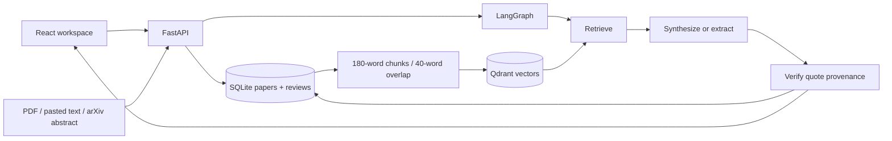

# ResearchPilot

A runnable scientific literature workspace built with **React + TypeScript, FastAPI, LangGraph, Qdrant, and SQLite**. Import sources, retrieve passages, produce citation-backed research briefs, compare papers, and explore a concept graph.

## Start on Windows

Prerequisites: Python 3.11–3.13 and Node.js 20.19+ / 22+. From this directory:

```powershell
.\start.ps1
```

Open http://127.0.0.1:8000. Interactive API documentation: http://127.0.0.1:8000/docs. The script installs dependencies, builds React, and serves the frontend and API from one origin. If script execution is restricted, execute the commands in `start.ps1` manually. Stop with Ctrl+C.

## Docker

```sh
docker compose up --build
```

The application is bound to localhost and persists data in the `research-data` volume. It is a personal research tool, not an authenticated public service.

## First research session

1. Choose **Explore demo** for three clearly labeled explanatory notes about RAG, DPR, and Self-RAG. They are original demo notes, not quotations from those papers.
2. Generate a review and expand a finding to inspect its exact supporting passage.
3. Use **Add papers** to discover and import arXiv abstracts, upload a text PDF, or paste source text with bibliographic metadata.
4. Check library paper boxes to scope your next review. With none selected, retrieval searches the whole library.
5. Compare 2–4 papers for the research question, inspect concept connections, revisit saved reviews, or export Markdown.

## Optional model synthesis

Copy `.env.example` to `.env` in this directory and set `LLM_API_KEY`, `LLM_BASE_URL`, and `LLM_MODEL` for a compatible chat-completions service. Restart the backend. The default endpoint is OpenAI; a compatible provider can be configured. Retrieved passages and your question are sent to that provider when a key is present. No key is sent to the browser.

Without a key, the app is fully functional in **extractive mode**: it ranks source sentences and quotes them verbatim. With a key, it synthesizes findings and verifies every supporting quote. Invalid source IDs or invented quotes are rejected. Model outages fall back to extracts with an explicit notice. This optional external integration requires a user-supplied key and was not validated against a paid provider.

## Architecture



`backend/app/store.py` owns persistence, chunking, embedding, and vector retrieval. HashingVectorizer generates normalized 2,048-dimensional lexical vectors with no downloads. Qdrant performs cosine search. SQLite is canonical; the in-process Qdrant index rebuilds on startup, so restarts preserve papers without a separate database server. Hashing vectors are a reproducible lexical baseline, **not pretrained semantic embeddings**. Large corpora should use a persistent Qdrant server and a semantic embedding model with an explicit reindex migration.

`backend/app/pipeline.py` defines real LangGraph retrieve → synthesize → verify nodes and captures execution details. This is a bounded autonomous workflow, not an open-ended tool-using research agent. Discovery is user-triggered, and the graph synthesizes only imported evidence.

`backend/app/main.py` provides import, arXiv discovery, reviews, comparison, graph, and health endpoints. React is served by FastAPI after a production build. Reviews snapshot their evidence, so deleting a paper does not erase historical provenance.

## Evidence and research limitations

- Verification establishes that a quote occurs in an imported passage. It does not prove that a paraphrased claim is entailed or scientifically true. The UI distinguishes exact extracts from interpretations needing review.
- arXiv discovery imports abstracts only and may be rate-limited. PDF extraction is text-only, with no OCR, table reconstruction, or page-level citations. Quotes link to passage IDs and optional source URLs.
- Comparisons are side-by-side retrieved passages, not independently validated methodological judgments.
- Knowledge graph edges represent deterministic mentions from a small concept vocabulary. They are not inferred causal links, citations, or an exhaustive scientific ontology.
- Relevance uses a low cosine threshold; inspect passages for topical adequacy. No recall, precision, or factual accuracy benchmark is claimed.
- This build is for one trusted local user. Before public hosting, add authentication, authorization, rate limits, request/body limits at the proxy, durable worker jobs, PDF sandboxing, backups, and an external vector service. Only run one backend worker with this local index.

## Development and tests

```sh
python -m venv .venv
# Activate .venv with the command appropriate to your shell.
pip install -r backend/requirements.txt
python -m pytest backend/tests -q
uvicorn app.main:app --app-dir backend --host 127.0.0.1 --port 8000
# In another terminal:
cd frontend
npm ci
npm run dev
```

Vite proxies `/api` to port 8000. For the browser smoke test, build the frontend, restart the backend so it mounts `dist`, then run `npm test` from `frontend`. The test configuration uses installed Google Chrome; remove `channel: 'chrome'` and run `npx playwright install chromium` to use Playwright's bundled browser instead. Browser tests use the running backend and add demo papers/reviews, so use a temporary `DATA_DIR` for clean test isolation.

Backend tests cover source verification, fabricated citations, import deduplication, scope filtering, comparison, deletion, graph construction, empty evidence, input validation, and persistence across restart. Browser tests cover review generation, evidence inspection, comparison, graph, history, and mobile overflow.

`backend/requirements-lock.txt` records the exact tested Python dependency set (with a Windows marker for pywin32); install it instead of `requirements.txt` to reproduce that environment. `frontend/package-lock.json` pins the frontend dependency tree. See `VALIDATION.md` for tested paths and untested integrations.

## API summary

| Endpoint | Purpose |
| --- | --- |
| GET `/api/health` | Runtime mode |
| GET/POST `/api/papers` | List/import text |
| POST `/api/papers/pdf` | Extract and import PDF |
| DELETE `/api/papers/{id}` | Delete a source |
| GET `/api/discover?query=...` | Search arXiv abstracts |
| POST `/api/demo` | Idempotently import demo notes |
| GET/POST `/api/reviews` | Saved history / run LangGraph review |
| POST `/api/compare` | Compare 2–4 selected sources |
| GET `/api/graph` | Paper–concept mention graph |

## Technical references

- [LangGraph graph API](https://docs.langchain.com/oss/python/langgraph/graph-api)
- [Qdrant Python client](https://python-client.qdrant.tech/)
- [arXiv API manual](https://info.arxiv.org/help/api/user-manual.html)

## Resume discussion

Describe this implementation as a local literature research platform with a LangGraph evidence workflow, lexical vector retrieval in Qdrant, optional model synthesis, and deterministic citation provenance checks. Be ready to explain the difference between quote validation and semantic entailment, why extraction is the no-key fallback, and what production scaling would require. Do not claim measured accuracy improvements, semantic embeddings, or production deployment without doing that additional work.
